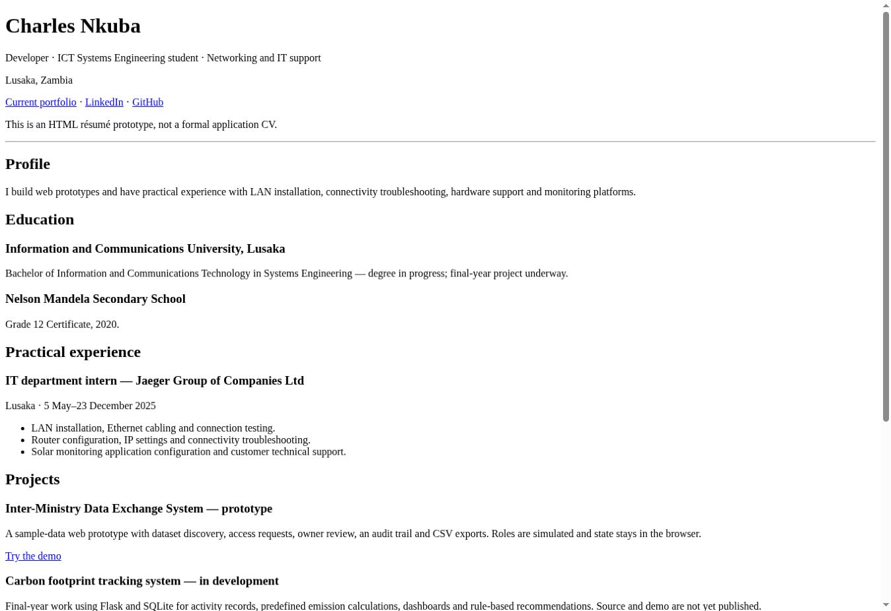

# Developer résumé website — prototype

A responsive résumé website by Charles Nkuba presenting development work, education, internship experience and direct links to live prototypes.

[Live résumé prototype](https://charlesnkuba.github.io/My-Resume/) · [Current portfolio](https://charlesnkuba.github.io/) · [LinkedIn](https://www.linkedin.com/in/nkubacharles8)



## What it demonstrates

Semantic HTML, responsive CSS Grid layouts, typography, project cards, keyboard focus, a persistent light/dark theme and print styling. JavaScript supports theme switching and the browser print dialog. Content includes my IT internship, Internet Fundamentals certificate and live prototype links. Education is marked as in progress.

The project is a résumé website prototype. It has no backend, database or authentication. The carbon footprint link opens a project overview, not the working Flask application.

## Run locally

Open `index.html` in a browser, or run:

```sh
python3 -m http.server 8000
```

Visit `http://localhost:8000/`. No dependencies or build step are needed.

## Structure

- `index.html`: résumé prototype
- `styles.css`: responsive light/dark and print styles
- `app.js`: theme preference and browser print control
- `Public/Contact Me.html`: professional contact links
- `Public/My Hobbies.html`: original interests page
- `docs/screenshots/resume.jpg`: captured live homepage preview

## Content maintenance

The old internship-seeking summary has been updated with current experience. A broken empty image was removed. Residential address, birth date, marital status and referee contact details are omitted from the current pages. Earlier commits can still contain historical content.

## Limitations and next work

Use **Print / Save PDF** to open the browser print dialog. The print stylesheet hides navigation/tools and produces a compact résumé layout. Theme preference is stored in the visitor’s browser; if storage is unavailable, switching still works for the current visit. Detailed cross-browser, mobile and assistive-technology testing remains future work. Application documents should be tailored for each role.
